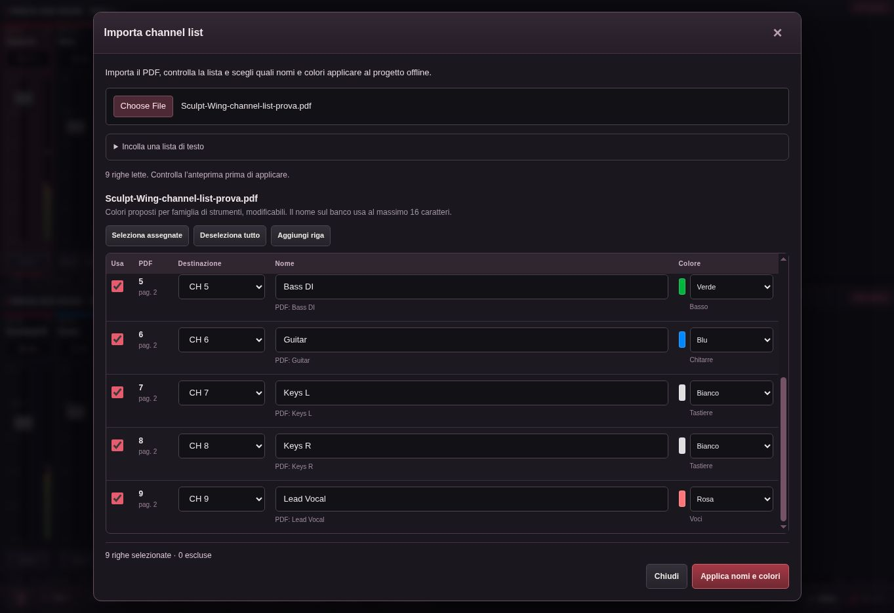

# Sculpt Wing 0.6.2 — channel list PDF e pannelli completati

## Contenuto

La versione aggiunge **Menu del banco → Importa channel list**. Il PDF viene letto sul dispositivo con un worker incorporato nell’app; l’anteprima consente di correggere ingressi CH/AUX, nomi, colori e righe selezionate. L’applicazione aggiorna solamente le identità del progetto offline e offre un annullamento selettivo nello stesso dialogo.

La palette richiesta dall’utente è batteria rosso, basso verde, chitarre blu, tastiere bianco, voci rosa, fiati giallo e archi arancio. L’editor del canale usa gli stessi colori; i colori personalizzati dei progetti precedenti restano intatti e vengono mostrati come colore attuale.

Sono stati completati i quattro filtri Tilt, Maxer, AP90 e AP180 e le cinque dinamiche Dual Dynamic EQ, PSE/LA Combo, Even 88 Compressor, LMT e One Knob Compressor. Il renderer basato sui riferimenti copre ora tutte le **108 definizioni non vuote** del catalogo; la 109ª definizione è lo slot vuoto `NONE`, con la propria vista dedicata.

La consegna mantiene scorrimento con mouse, fader dalla testa, mandate verticali e Custom Layer a due righe della 0.6.1. Le macro sono invariate. Monitor e IEM verranno definiti dall’utente in un passaggio successivo.

## Verifica del codice

Ambiente di verifica: Linux, Node 24.22.1. Le prove non costituiscono un collaudo della nuova app su macOS o sulla WING fisica.

| Verifica | Esito |
| --- | --- |
| Build TypeScript e bundle app, reader e worker PDF | Superata |
| Suite native | 99 test superati |
| Suite web, modello, importatore e pannelli | 128 test superati |
| Integrazione editor | 456 render su 76 strip superati |
| Suite desktop, trasporto e CSP | 18 test superati |
| Preparazione del pacchetto desktop | Superata |
| Coerenza package/lockfile, asset index/cache e bundle incorporati | Superata |

Totale: **245 test automatici**, oltre all’integrazione editor a 456 render.

Il reader è stato provato con il vero motore PDF.js e il worker distribuito: tabella su due pagine, coordinate dopo rotazione/crop/UserUnit, documento senza testo, password, limite pagine, annullamento e timeout. L’adattatore di test sostituisce soltanto il trasporto Web Worker con worker_threads; non simula l’estrazione.

L’importatore è stato verificato con l’app e il controller reali: duplicati bloccanti, ingressi fuori intervallo, intestazioni e colonne, due tabelle affiancate, coppie L/R, anteprima senza modifiche premature, persistenza, blocco live, cambio sessione durante il commit, annullamento selettivo e colori visibili nell’editor.

## Verifica nella UI

Nella preview dell’interfaccia, usando la policy di sicurezza desktop, è stato selezionato un PDF reale di prova con nove ingressi su due pagine. I nove nomi sono stati estratti senza includere la colonna microfoni. Sono stati verificati modifica manuale del nome, applicazione, annullamento, nuova applicazione, persistenza al riavvio della pagina e aggiornamento delle strip nel Custom Layer. I livelli esistenti, compreso CH 1 a +3,7 dB, sono rimasti invariati.

La palette richiesta compare sia nell’anteprima sia nell’editor. La finestra mantiene visibili i comandi mentre la tabella scorre. Il lettore PDF ha funzionato con `worker-src 'self'` e `connect-src 'none'`; non sono comparsi errori dell’app.

Sono state ispezionate le cinque nuove dinamiche confrontandole con le schermate di riferimento. Nel DEQ2 il cambio DEQ 1/DEQ 2 seleziona i controlli della banda corretta. Nel filtro AP180, passando da 1000 a 2000 Hz, il marker si sposta sulla frequenza effettiva. Le prove sul codice coprono anche binding, bypass, isolamento e controlli live ambigui.

## Limiti attuali

- Il PDF deve contenere testo selezionabile. L’OCR per scansioni non è incluso. I documenti misti segnalano le pagine senza testo.
- Il riconoscimento di una channel list non è universale: numerazioni o impaginazioni ambigue richiedono controllo nell’anteprima. Nessun PDF reale dell’utente era allegato durante questa verifica.
- L’importazione prepara nomi e colori nel progetto Sculpt offline. Non invia una scena al banco, non genera uno snapshot WING e non modifica mandate monitor/IEM, livelli, patch, phantom o processing.
- Le superfici dei processori sono ricostruzioni HTML/CSS/SVG basate sui riferimenti. Non viene dichiarata identità pixel per pixel; i meter senza dati e le risposte proprietarie non sono simulati. Per i filtri, la riga accessibile dei parametri è un adattamento rispetto al ritaglio disponibile.
- I due controlli `peak` e `peak__2` di PSE/LA Combo restano in sola lettura in live: il riferimento assegna a entrambi la stessa chiave sorgente. Gli altri cinque parametri restano utilizzabili.
- La build Mac M1/arm64 0.6.2 deve ancora essere eseguita dal workflow GitHub e provata sul Mac dell’utente. Il caricamento del PDF è stato verificato nella UI web con la CSP desktop, non attraverso il protocollo `sculpt://app` di un binario macOS in esecuzione.

## Repository e distribuzione

Il pacchetto è cumulativo e conserva la 0.6.1 caricata dall’utente nel commit `7fc4cf2f56c7c84d5def08a2937634b0c1afdc43`. I 31 file di quel caricamento sono stati confrontati con la consegna precedente: gli hash coincidono. Il workflow incluso mantiene il solo target Mac Apple Silicon arm64/M1 e verifica architettura e firma ad hoc.

L’accesso GitHub ha restituito 403 alla scrittura nella sessione. Non sono stati pubblicati automaticamente cambiamenti al repository. Le istruzioni di caricamento e sostituzione dell’app sono in `LEGGIMI.txt`.

PDF.js è fissato alla versione 6.5.438. La build richiede Node almeno 22.13.0; il workflow usa la versione 22 aggiornata. Licenza Apache e intestazioni copyright sono conservate negli asset distribuiti.

Dettagli: [importazione channel list](CHANNEL_LIST_IMPORT.md) e [pannelli originali](PLUGIN_ORIGINAL_SURFACES.md).
