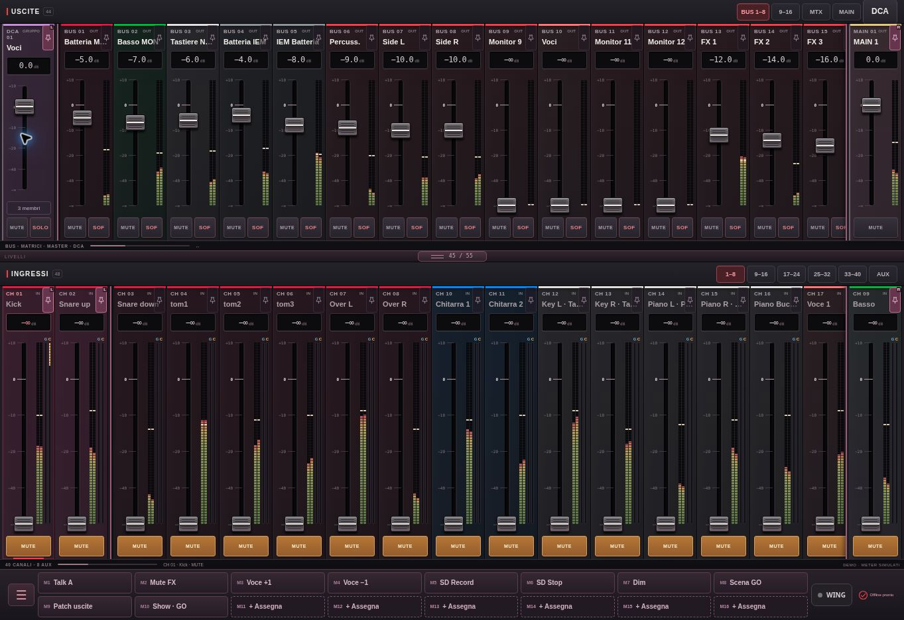
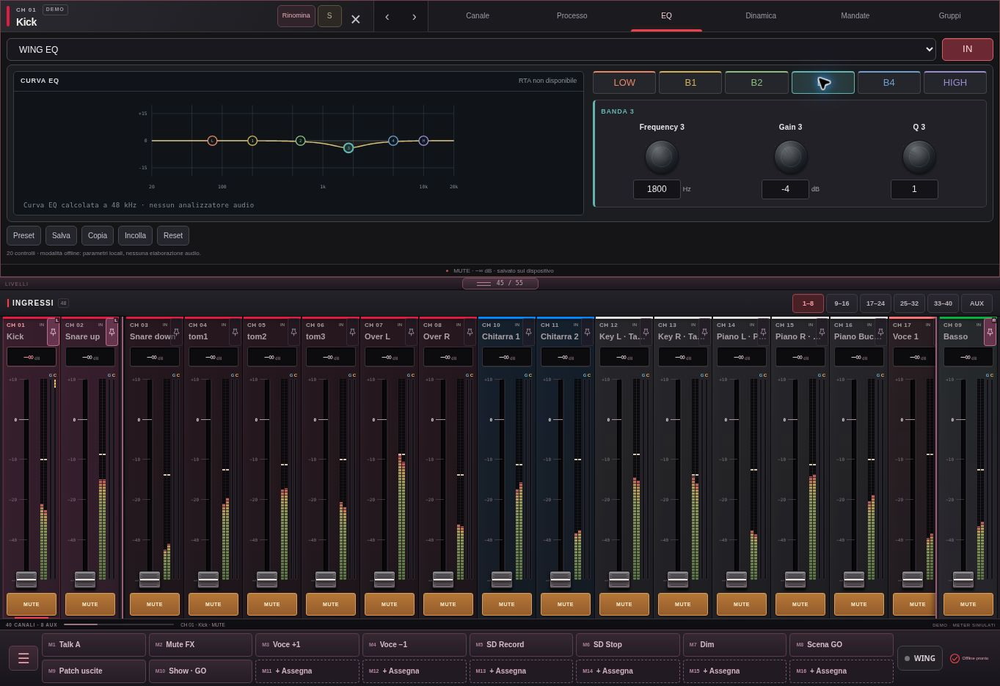
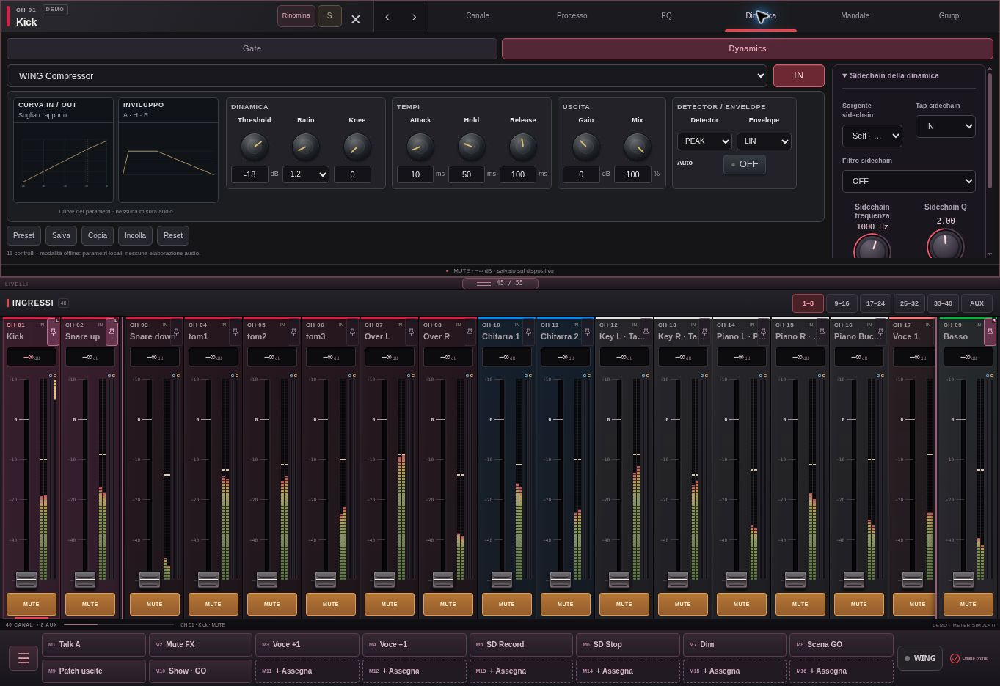
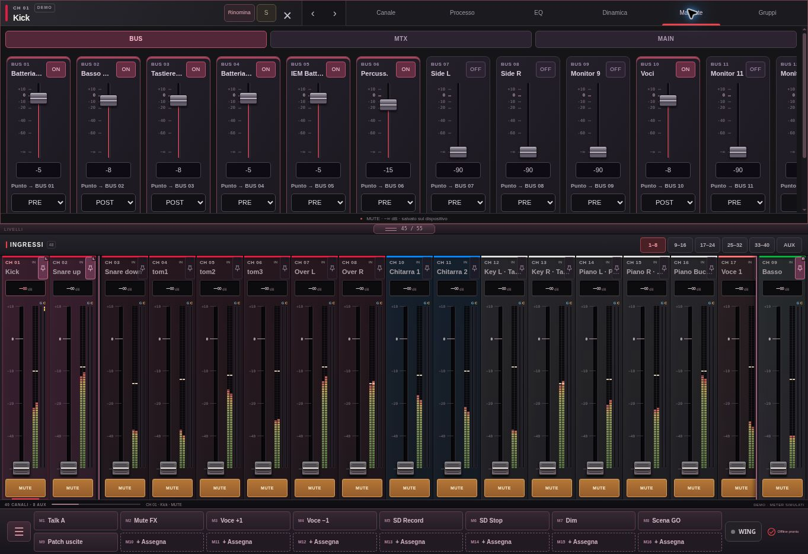
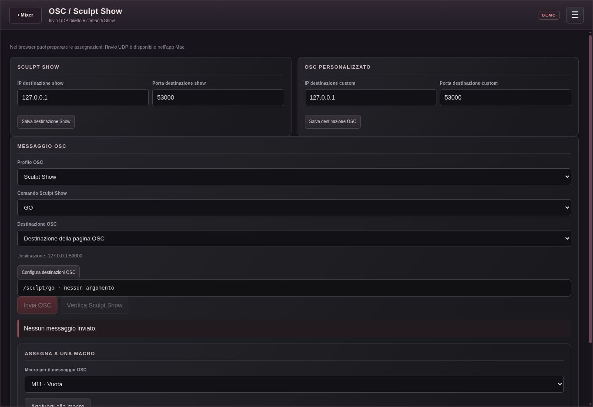

# Sculpt Wing 0.6.7 — DCA, editor WING, annullamento e OSC

Questa versione raccoglie gli interventi sull’uso quotidiano del mixer: DCA nella riga superiore, editor WING EQ e Dynamics più leggibili, mandate compatte, annullamento delle operazioni e invio OSC diretto a Sculpt Show. Il target di distribuzione resta **Mac M1 / Apple Silicon ARM64**.

## DCA insieme alle uscite

I **16 DCA** fanno parte della riga superiore insieme a BUS, matrici e master. Il pulsante **DCA** porta ai DCA tramite lo scorrimento della riga; gli altri canali e gli ancoraggi restano presenti.

Ogni DCA può essere ancorato **a sinistra o a destra**, riordinato fra gli elementi ancorati e liberato come gli altri canali. Gli ancoraggi sono preferenze locali e vengono conservati. Nei Custom Layer, i DCA appartengono alla riga superiore e possono essere ordinati insieme alle uscite scelte.

Nome, membri, fader, mute e solo restano accessibili dalla strip DCA. Il DCA è un controllo di gruppo e non presenta un meter audio simulato. In live, un valore non ancora letto dal banco rimane indicato come non disponibile.

## WING EQ e WING Dynamics

Il pannello nativo **WING EQ** riunisce grafico, scelta della banda e manopole in una superficie orizzontale. Selezionare una banda sul grafico o tramite la sua scheda mostra i controlli corrispondenti. Frequenza, guadagno e Q non sono più ripetuti in due gruppi di controlli. Le uscite mantengono le proprie bande e i controlli specifici, compreso Tilt.

I pannelli **Compressor, Expander, Gate e Ducker** della famiglia WING organizzano i parametri per dinamica, uscita, tempi e detector. Le curve aiutano a leggere le impostazioni; manopole e selettori restano collegati agli stessi parametri e limiti del processore. Le superfici degli altri modelli rimangono disponibili.

### Cosa mostrano i grafici

**L’analizzatore audio RTA non è implementato.** La dicitura **CURVA EQ / RTA non disponibile** distingue la risposta calcolata dei filtri da uno spettro misurato. La curva WING EQ usa un riferimento di 48 kHz; il Tilt delle uscite non è incluso nella curva e viene segnalato nel pannello.

Anche le curve della dinamica rappresentano i parametri impostati, senza misurare il segnale. I piccoli indicatori G/C sulle strip restano separati: in live possono mostrare soltanto la riduzione di guadagno ricevuta dalla WING. I grafici degli editor non dimostrano la presenza di un flusso audio o di un analizzatore funzionante.

## Mandate verticali e più compatte

Le mandate rimangono **verticali**, con strip più strette e corsa del fader ridotta per la vista orizzontale. La manopola che duplicava il livello della mandata è stata eliminata: il livello si modifica con il fader o con il campo numerico. Pan e gli altri valori indipendenti conservano i rispettivi controlli.

Il fader si trascina dalla testa. Un clic sul binario non cambia il livello; il doppio clic porta a **0 dB**.

## Cmd+Z e ripristino

**Cmd+Z** annulla l’ultima modifica registrata; **Maiusc+Cmd+Z** la ripristina. Gli stessi comandi sono disponibili nel menu **Banco**. Il trascinamento di un fader, di una manopola o di un punto EQ costituisce una sola operazione, anche quando cambia più parametri o produce molti aggiornamenti intermedi.

La cronologia conserva i campi coinvolti nella modifica. L’annullamento di un livello o di un parametro non ripristina un’intera copia del progetto e non cambia routing o altri valori estranei all’operazione. Quando il cursore si trova in un campo di testo, le scorciatoie restano dedicate alla modifica del testo.

In una sessione WING, annullamento e ripristino sono soggetti agli stessi controlli delle scritture normali:

- devono riferirsi alla sessione corrente e a parametri ancora compatibili;
- verificano i valori correnti prima di applicare la modifica e rifiutano un conflitto con modifiche più recenti;
- attendono il riscontro delle scritture del banco; se manca la conferma, mostrano un errore e richiedono di controllare i valori ricevuti;
- durante l’attesa, non accettano nuove modifiche dell’utente che rimarrebbero fuori dalla cronologia.

**Il cambio di algoritmo di un processore live non si annulla con Cmd+Z.** Ripristinare solo il nome dell’algoritmo non ricostruirebbe tutti i parametri precedenti: per quel ripristino occorre un preset del processore. Il cambio di algoritmo nel progetto offline resta gestito dalla cronologia.

La cronologia delle modifiche non è un meccanismo di annullamento per comandi già eseguiti in altre applicazioni: **Cmd+Z non invia messaggi OSC inversi**.

## Interventi sulle prestazioni

Gli aggiornamenti più frequenti sono stati circoscritti al lavoro necessario:

- la cronologia di fader e parametri acquisisce il solo ambito modificato;
- i salvataggi locali ravvicinati vengono raccolti in una breve finestra di 180 ms;
- i meter aggiornano le strip visibili e quelle ancorate, con pausa quando la pagina è nascosta o un workspace copre il mixer;
- i pannelli dei processori ignorano notifiche che non cambiano i propri dati, e le curve EQ vengono ricalcolate quando cambiano i parametri interessati;
- DCA, etichette e pulsanti evitano aggiornamenti ripetuti per modifiche estranee.

Il confronto fra 0.6.6 e 0.6.7 usa **tre campioni per versione e scenario, ciascuno con 120 aggiornamenti**, con l’editor WING EQ di CH 1 aperto. I tempi mediani del lavoro sincrono misurato sono:

| Scenario | 0.6.6 | 0.6.7 | Riduzione del tempo |
| --- | --- | --- | --- |
| 120 modifiche del guadagno EQ | 3.856,962 ms | 436,851 ms | 88,7% |
| 120 modifiche del fader canale | 2.536,646 ms | 328,867 ms | 87,0% |

In entrambi gli scenari, le scritture al salvataggio locale passano da **120 a 1**, comprendendo il salvataggio finale. Nella 0.6.7 il test rileva **zero modifiche DOM sulle strip estranee all’operazione**.

Metodo, campioni e impronte dei sorgenti sono in [benchmark-ui-results.json](verification/benchmark-ui-results.json). La misura usa Node 24.22.1 e JSDOM 26.1.0 su Linux x64: comprende l’elaborazione dei comandi, le modifiche DOM e il salvataggio finale, ma esclude disegno e layout del browser, frame dei meter, rete e hardware. **Non misura FPS, latenza audio o prestazioni native del Mac M1.**

## OSC diretto e Sculpt Show

L’app Mac invia **OSC via UDP direttamente**, senza un’app ponte. La pagina **OSC / Sculpt Show** permette di preparare e inviare un messaggio, verificare Show oppure aggiungere il messaggio a una macro. OSC resta disponibile anche senza WING collegata.

Il profilo Show parte da **127.0.0.1:53000**. I preset seguono il contratto di **Sculpt Show 1.0.0 RC3, build 3** e comprendono GO, Stop All, pausa, ripresa, fade, navigazione e comandi per cue o liste specifiche. Questi ultimi richiedono l’UUID, non il numero mostrato della cue. È disponibile anche un profilo OSC personalizzato con argomenti tipizzati.

**Verifica Sculpt Show** richiede lo stato tramite `/sculpt/status`, senza avviare o fermare cue. Un normale invio conferma invece solo che il sistema ha accettato il datagramma UDP: l’esecuzione nel destinatario non è confermata. I messaggi già inviati non possono essere ritirati.

La [guida OSC e Sculpt Show](OSC_SCULPT_SHOW.md) riporta configurazione, comandi, versione del ricevitore verificata nei sorgenti e limiti. La [guida alle macro](MACROS.md) descrive le sequenze miste WING, OSC e navigazione. Nel browser si possono preparare le assegnazioni; l’invio UDP richiede il trasporto nativo dell’app Mac.

## Distribuzione e verifiche

Il workflow **Build Sculpt Wing - Mac M1** mantiene il target ARM64. **La build macOS su GitHub Actions deve ancora essere eseguita dopo il caricamento dei sorgenti.** I test di sviluppo e la preparazione del frontend non sostituiscono la compilazione, l’apertura dell’app sul Mac e il collaudo fisico.

| Verifica finale della consegna | Esito |
| --- | --- |
| Protocollo e app nativa | 100 test superati |
| Modello, importazione, interfaccia, cronologia e macro | 322 test superati |
| Desktop, socket, PDF e trasporto OSC | 28 test superati |
| Totale test automatici | **450 test superati** |
| Rendering degli editor | **456 render completati** |
| Build di sviluppo e preparazione del frontend desktop | Riuscite anche dopo l’ultimo CSS; bundle e asset controllati prima della creazione dello ZIP |
| Prova interattiva del frontend | DCA, ancoraggio, annullamento/ripristino, EQ, mandate e assegnazione OSC verificati come descritto sotto |
| Confronto prestazioni nell’ambiente di sviluppo | Completato — [risultati](verification/benchmark-ui-results.json) |
| Compilazione macOS ARM64 su GitHub Actions | Da eseguire |
| Avvio e uso della 0.6.7 su Mac M1 | Da eseguire |
| Collaudo con una WING fisica | Non eseguito |
| Collaudo fra le app Wing e Show aperte sul Mac | Da eseguire |

La prova interattiva nel browser ha verificato:

- DCA 1 ancorato a sinistra con i BUS ancora presenti nella riga superiore;
- Cmd+Z e Maiusc+Cmd+Z sul fader DCA, e annullamento del guadagno EQ;
- 16 fader verticali delle mandate con altezza osservata di 128 px e nessuna manopola duplicata per il livello;
- assegnazione di Show GO a M10, con indirizzo `/sculpt/go` e destinazione iniziale `127.0.0.1:53000`;
- invio UDP disabilitato nel browser, coerentemente con la necessità del trasporto nativo.

Il controllo finale a 1363 × 936 px, con ripartizione delle righe 45 / 55, mostra tutti gli otto controlli principali del WING Compressor nella stessa fascia orizzontale: soglia, rapporto, knee, attack, hold, release, gain e mix. Nella superficie dei controlli non occorre scorrere verticalmente; le dimensioni osservate sono 1113 × 177 px, uguali alle dimensioni del contenuto. Verificato anche WING Gate / Expander. Il ricaricamento mantiene gli ancoraggi e l’assegnazione Show GO a M10; il doppio clic sul fader DCA ripristina 0 dB.

### Schermate della prova

La demo usata per queste immagini contiene dati di prova: non è lo stato letto da un mixer reale. Ulteriori viste: [WING Gate](images/067-wing-gate.jpg), [macro Show GO](images/067-macro-show-go.jpg).

Le prove OSC in loopback con un ricevitore di test controllano trasporto e contratto dei messaggi; non equivalgono al collaudo della propria installazione Show. Per la prova pratica seguire [Collaudo WING e Show 0.6.7](COLLAUDO_WING_SHOW_0.6.7.md).
