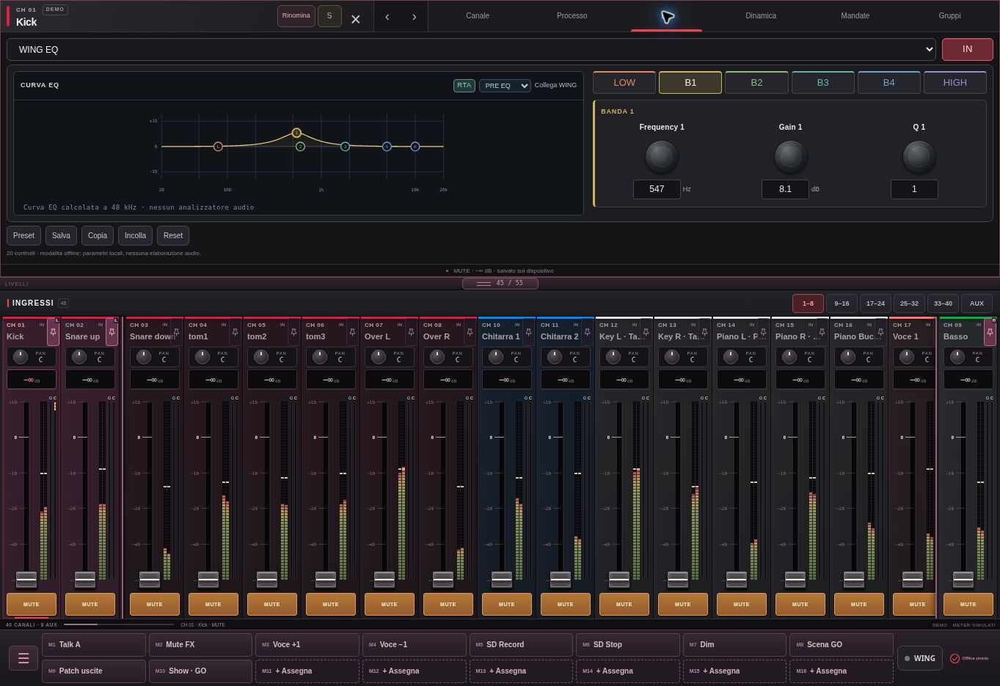
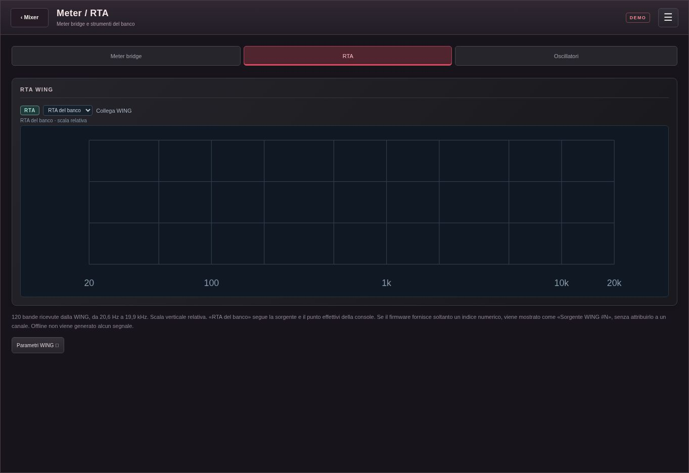

# Sculpt Wing 0.6.8 — Mac M1

La 0.6.8 aggiunge il **pan sulle strip con doppio clic al centro**, mantiene il modulo dell’editor quando si cambia canale, corregge il trascinamento dei punti EQ e riduce il lavoro dell’interfaccia. Include la ricezione del **RTA reale WING**, con una vista globale del banco e un overlay EQ disponibile soltanto quando la sorgente è identificabile.

La consegna è un aggiornamento dei sorgenti per il repository `mrgianluca990-bit/Sculpt-Wing`, verificato alla 0.6.7 sul commit `765149942d8ef083bfa1c8c8191d30f1a38d12a2`. Il workflow produce il solo target **macOS ARM64 / Apple Silicon**.

## Pan sulle strip

Il nuovo controllo è sopra il fader delle strip audio, compresi ingressi, AUX, BUS, MAIN e MTX.

- Trascina orizzontalmente o verticalmente per regolarlo; Maiusc rende il movimento più preciso.
- **Doppio clic: centro, indicato con C.** Il reset del livello del fader rimane un comando separato sul fader stesso.
- Un trascinamento costituisce una sola operazione nella cronologia Cmd+Z / Maiusc+Cmd+Z.
- In SOF sulle strip CH/AUX, il controllo riguarda il pan della mandata selezionata. Se Pan link è attivo, mostra LINK e segue il pan del canale.
- Valori non ancora ricevuti, metadati mancanti e modalità di sola lettura non abilitano scritture. Un annullamento live in attesa non accumula movimento del puntatore.

I DCA rimangono nella riga superiore e possono essere ancorati; non hanno un proprio pan audio. Il pan delle strip funziona anche nelle posizioni ancorate e nei custom layer.

## Continuità dell’editor

Con l’editor aperto, selezionare un altro canale mantiene **Canale, Processo, EQ, Dinamica, Mandate o Gruppi**, invece di tornare sempre alla pagina iniziale. Le sottoviste Gate/Dynamics e le selezioni delle mandate vengono mantenute quando sono compatibili con la nuova strip. Una macro che richiama espressamente un modulo apre direttamente quel modulo.

Il campo in corso di modifica viene confermato sul canale precedente prima del cambio di selezione. Le letture asincrone della vecchia vista non possono sovrascrivere il nuovo editor. Il pannello continua ad aprirsi nella riga opposta a quella del canale selezionato.

## Precisione EQ

Il puntatore viene convertito nelle coordinate effettive del grafico SVG, considerando ridimensionamento e rapporto d’aspetto. Il clic iniziale non modifica i parametri: trascinando dal bordo del punto si conserva la distanza fra puntatore e centro della banda. Premere o rilasciare Maiusc durante il gesto cambia la precisione senza introdurre un salto.

Frequenza e gain vengono aggiornati insieme. Il grafico riutilizza i calcoli delle bande rimaste uguali e interrompe i gesti non più validi dopo chiusura dell’editor, cambio di contesto o rifiuto di una modifica live.

Nella prova nel browser, un trascinamento di circa **60 pixel a destra e 20 verso l’alto**, iniziato fuori dal centro del punto, ha spostato la banda di **59,97 / −19,99 pixel**, conservando il punto di presa. È una verifica dell’interfaccia; non attesta il comportamento del firmware con il mixer collegato.

## Prestazioni

Sono state rimosse le ricostruzioni duplicate dell’editor. La registrazione di una macro di navigazione non provoca più un aggiornamento generale del mixer; i custom layer vengono salvati solo se cambiano. I salvataggi del progetto sono raggruppati e differiti dopo una breve pausa nelle modifiche, preferendo i momenti di inattività dell’interfaccia, con scaricamento delle modifiche pendenti alla chiusura o al passaggio in background.

Le letture delle dimensioni precedono gli aggiornamenti del layout; vengono evitati aggiornamenti DOM equivalenti e meter coperti dall’editor. Il pan usa riferimenti e valori grafici già disponibili; gli aggiornamenti RTA non passano dalla cronologia del progetto.

Mediane dei tre campioni per scenario, in millisecondi. Il totale comprende il salvataggio finale.

| Scenario | Totale 0.6.7 | Totale 0.6.8 | Riduzione | p95 per operazione 0.6.7 → 0.6.8 |
| --- | ---: | ---: | ---: | ---: |
| 40 cambi canale con EQ aperto | 2152.00 | 621.80 | 71.1% | 85.09 → 29.03 |
| 40 aperture dirette EQ | 2183.33 | 797.11 | 63.5% | 69.19 → 38.15 |
| 40 aperture EQ da macro | 3625.70 | 983.84 | 72.9% | 117.03 → 37.47 |
| 120 regolazioni gain EQ | 871.92 | 210.05 | 75.9% | 10.97 → 2.61 |
| 120 regolazioni fader | 399.46 | 190.69 | 52.3% | 5.35 → 1.91 |
| 120 movimenti del punto EQ, due assi | 1227.62 | 243.01 | 80.2% | 15.87 → 3.00 |

Nelle navigazioni, le ricostruzioni del pannello scendono da **120 a 40**. Le macro passano da **41 a 1** scrittura storage per campione. Il trascinamento EQ dimezza transazioni e notifiche. Il RTA introduce due elementi SVG aggiuntivi per apertura EQ; il componente è incluso nel benchmark, senza flusso audio offline.

Per il cambio canale, il confronto include nella 0.6.7 anche il clic necessario per riaprire EQ; nella 0.6.8 il modulo resta selezionato. Non sono solo tempi del singolo clic: viene confrontato il completamento dello stesso compito. Nessuno dei sei scenari mostra regressioni delle mediane di totale, p50 o p95.

Il confronto usa i sorgenti 0.6.7 e 0.6.8 in processi Node/JSDOM isolati, con tre campioni alternati per scenario. Il bundle 0.6.8 include anche il modulo RTA. Misura il lavoro JavaScript/DOM del percorso esercitato: **non misura repaint CSS, frequenza dei fotogrammi su Mac, trasporto di rete o risposta audio della WING**. I numeri non sono una promessa della stessa percentuale di miglioramento su un Mac M1.

Dati, metodo e impronte dei file sono conservati in [verification/068](verification/068/README.md).

## RTA: comportamento e disponibilità

**Meter / RTA → RTA** riceve le 120 bande dell’analizzatore WING attraverso il trasporto nativo già presente nell’app. Non richiede un’altra applicazione. La vista segue la sorgente e il punto di prelievo effettivi della console; senza connessione il grafico resta vuoto e indica **Collega WING**.

Il protocollo standard espone la sorgente come un indice numerico, senza una tabella verificata che lo associ alle famiglie CH/AUX/BUS/MAIN/MTX. In quel caso la vista mostra **Sorgente WING #N**. **L’overlay sull’EQ del singolo canale non viene attivato sulla base di un numero ipotizzato:** richiede un’identità della sorgente verificabile dai dati e dai metadati ricevuti. Il controllo **Banco** dell’EQ permette di aprire direttamente l’analizzatore globale quando la fonte non è associabile.

La scala verticale è **relativa**, normalizzata per fotogramma. Permette di osservare la distribuzione delle frequenze, ma non è una misura calibrata in dBFS o dB SPL e non confronta il volume assoluto nel tempo. Il banco condivide un solo analizzatore e il suo display può avere priorità sulla scelta remota. La guida [RTA_WING.md](RTA_WING.md) documenta fonti, formato, scala, gestione della sorgente e limiti.

L’aggiornamento grafico è limitato a dieci volte al secondo. Chiudere o nascondere la vista interrompe la richiesta dello spettro; dati scaduti, risposte di sessioni precedenti e pacchetti non validi vengono scartati. Non viene generato uno spettro audio dimostrativo offline.

## Verifiche della consegna

| Verifica | Risultato |
| --- | --- |
| Test nativi TypeScript | **104/104 passati** |
| Test web Node | **366/366 passati** |
| Test shell desktop | **28/28 passati** |
| Totale test automatici | **498 passati, 0 falliti** |
| Rendering delle pagine dell’editor | **456 viste su 76 strip**, completato |
| `npm run build --prefix native` | TypeScript e bundle frontend completati |
| `npm run prepare:app --prefix desktop` | Bundle desktop preparato |
| Browser, 1363 × 936 | Pan e reset, continuità EQ, trascinamento EQ, RTA offline e layout verificati |
| Console dell’app durante la QA browser | Nessun errore o avviso dell’app rilevato |

L’ultima correzione dopo la suite riguarda soltanto lo spazio della barra RTA in CSS: verificata nel browser e riportata in tutte le copie generate. I file JavaScript misurati dal benchmark coincidono con quelli della consegna. Log e controlli di coerenza sono in [verification/068](verification/068/README.md).

**Non eseguiti qui:** compilazione e avvio del binario macOS su Mac M1, collaudo con WING fisica, calibrazione verticale RTA e nuovo collaudo OSC con Sculpt Show. Il frontend compilato e i test dei trasporti non sostituiscono queste prove. La procedura pratica è in [COLLAUDO_0.6.8.md](COLLAUDO_0.6.8.md).

## Compilazione e installazione su Mac M1

1. Estrai `Sculpt-Wing-0.6.8-Aggiornamento-Mac-M1.zip` e carica i file nel repository esistente conservando i percorsi e gli altri file già presenti.
2. Esegui il commit su `main`. In **Actions**, attendi **Build Sculpt Wing - Mac M1**; può essere avviato anche con **Run workflow**.
3. Scarica l’artifact **Sculpt-Wing-Mac-M1** dell’esecuzione riuscita.
4. Estrai `Sculpt-Wing-0.6.8-mac-arm64.zip`, chiudi la vecchia app e sostituiscila con **Sculpt Wing.app** in Applicazioni.

Il workflow usa un runner Mac Intel con target ARM64 esplicito. Verifica architettura e firma ad hoc dell’eseguibile prima di creare l’artifact. Il file consegnato qui contiene i sorgenti aggiornati; il nuovo binario Mac viene prodotto da GitHub. Procedura completa: [CARICA_SU_GITHUB.md](../CARICA_SU_GITHUB.md).
