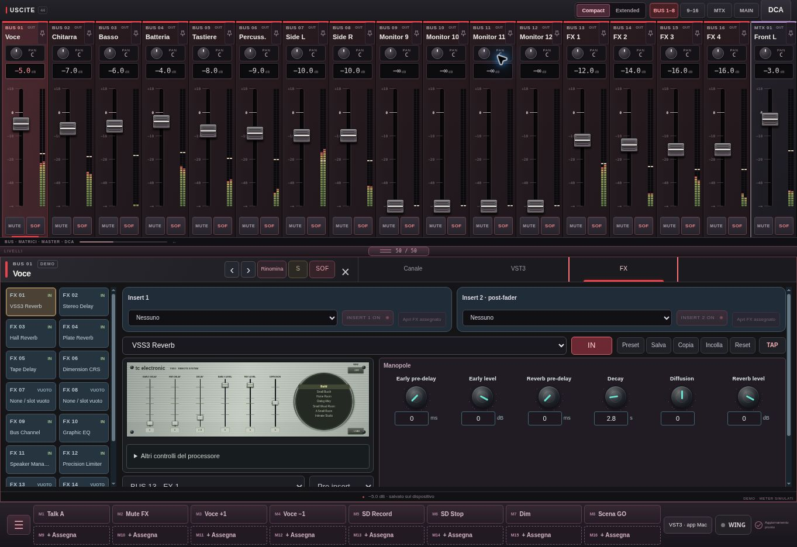
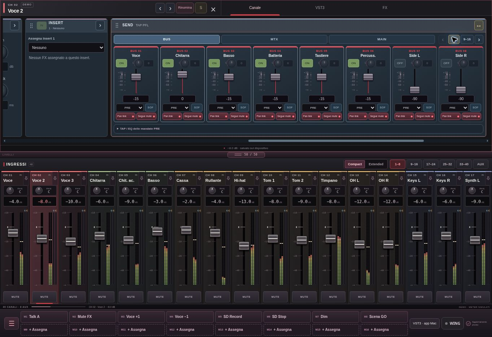
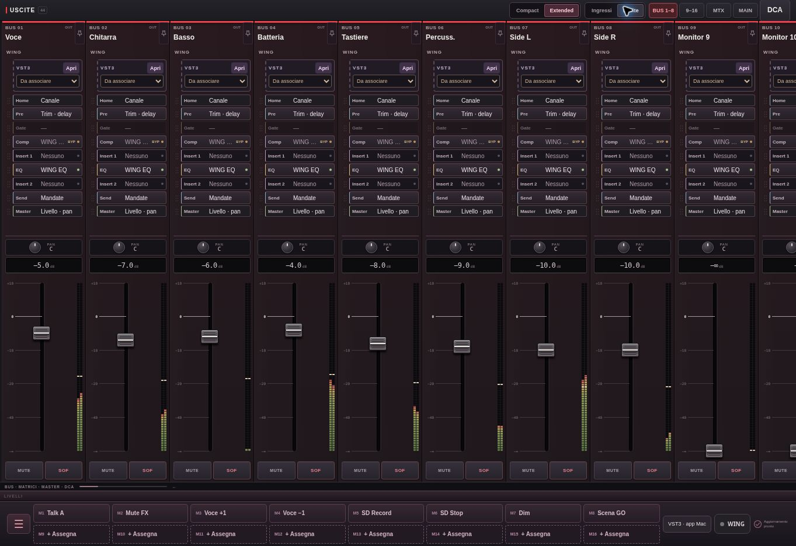

# Sculpt Wing 0.7.3 · Verifica della consegna

Data: **16 novembre 2026**. Base: `0822af31972246e2ed6a2cd432cd9055a96f1f74`, versione 0.7.2 del repository Sculpt-Wing. La consegna contiene i sorgenti aggiornati per la compilazione **Mac M1 / Apple Silicon ARM64**.

## Esito dei controlli locali

I controlli locali sono stati eseguiti in ambiente Linux. Le prove JavaScript usano i controller reali dell’app con trasporti e dispositivi di test; non attestano il funzionamento di una WING fisica o dell’host JUCE su macOS.

| Controllo | Esito |
|---|---|
| Build TypeScript e bundle dell’interfaccia (`npm run build --prefix native`) | Superata |
| Suite TypeScript (`npm run test:all --prefix native`, prima fase) | **112/112 superati**, 8 file |
| Suite web (`npm run test:all --prefix native`, seconda fase) | **572/572 superati**, nessun test saltato |
| Integrazione dell’editor (ultima fase della stessa suite) | **456 aperture su 76 strip superate** |
| Desktop: IPC, TCP/UDP e controllo host (`npm test --prefix desktop`) | **44/44 superati** |
| C++17: `audio-host/Tests/RoutingTest.cpp` | Compilato ed eseguito; routing e placement superati, nessun dispositivo audio aperto |
| Preparazione contenuti Electron (`npm run prepare:app --prefix desktop`) | Superata; asset finali copiati, CSP e versione 0.7.3 presenti |
| Sintassi | File JavaScript modificati e `ProtocolSmoke.py` verificati; YAML del workflow valido |
| Completezza asset | 57 riferimenti locali di `index.html` e 60 asset del service worker presenti, compreso il nuovo router VST/WING |
| Diff | `git diff --check` superato |

La suite completa termina con codice di uscita **0**. In totale sono superati **728 test automatici**, oltre alla prova delle 456 aperture dell’editor e al controllo C++ del routing.

Log: [build interfaccia](verification/073/interface-build.log), [suite completa](verification/073/test-all.log), [suite desktop](verification/073/desktop-tests.log).

Le verifiche aggiunte coprono navigazione Canale/VST3/FX, conservazione del modulo selezionato, Send a otto strip, Extended, metadati di posizione del rack, operazioni asincrone sul canale corretto e percorso WING. Il router dispone di 23 prove mirate su preparazione senza scritture, applicazione esplicita, conflitti, mute temporaneo, ripristino condizionale, riconnessione, persistenza e variazioni esterne.

Sono state aggiornate le fixture che attendevano le vecchie schede separate o un blocco globale dell’editor. Le nuove asserzioni verificano il blocco della sola scheda non ancora letta, l’assenza di scritture dai controlli indisponibili e il funzionamento dei controlli già confermati. Le verifiche di rinomina CLINK, readback, disconnessione e conservazione del routing restano attive.

Le esecuzioni con il parallelismo predefinito hanno segnalato timeout nelle fixture DOM della cronologia e dell’interfaccia. Le sei prove della cronologia sono passate isolate; i due casi interessati hanno impiegato circa 2,9 e 2,3 secondi, contro un limite di 8 secondi. I runner web e Vitest ora eseguono **al massimo due file alla volta**, evitando di sovraccaricare i runner condivisi con i DOM completi del mixer. Nessuna asserzione è stata eliminata e nessun timeout è stato aumentato.

## Verifica visiva

Anteprima dei file effettivi di `dist/`, in browser con viewport **1363 × 936**. Si tratta della modalità demo dell’interfaccia, senza motore audio Mac né collegamento a un mixer.

- **Navigazione:** tre schede principali, Canale / VST3 / FX. Il cambio Compact/Extended conserva la scheda aperta. L’editor di un ingresso si apre nella riga opposta; in Extended occupa l’area dei processori sopra i fader.
- **FX:** 16 slot selezionabili, renderer esistente dell’effetto, assegnazioni Insert 1 e Insert 2. Verificati nella vista Compact e nella vista Extended.
- **VST3:** otto slot A–H, scelta della posizione, Audio USB e pannello del percorso WING. Nel browser i comandi che richiedono il motore Mac rimangono correttamente indisponibili.
- **Send:** otto strip complete nel banco, con fader, valore, pan e opzioni previste. Verificati il passaggio 1–8 / 9–16 e il cambio di canale mantenendo modulo e banco. Alla prima espansione si vede l’inizio del mixer; le regolazioni non riportano la schermata all’inizio.
- **Extended:** corretta l’interferenza con le proporzioni delle due righe. Con un solo banco visibile, la riga usa lo spazio disponibile: nella prova misura 841 px, il rack 326 px e la zona fader 312 px. I nove moduli sono presenti e l’editor termina prima dei controlli pan/fader.

Non è stata eseguita una misura comparativa delle prestazioni. La verifica visiva non sostituisce una prova sul display e sul Mac dell’utilizzatore.

### Immagini della verifica

#### FX nella vista Compact

#### Send a otto strip

#### Extended a tutta altezza

Ulteriori immagini: [VST3](verification/073/vst3.jpg), [FX in Extended](verification/073/fx-extended.jpg).

## Compilazione ARM64 da eseguire su GitHub

Il workflow è stato corretto per compilare il motore VST3 prima di includerlo nell’app Electron. Il controllo statico ha verificato la coerenza di versione, percorsi CMake, risorse incluse, architettura, firma ad hoc e nome dell’artifact.

Il job Mac esegue:

1. Verifica del runner ARM64 e compilazione dell’interfaccia.
2. Test desktop sul Mac.
3. Compilazione Release di `SculptWingAudio` e del VST3 di prova.
4. CTest, elaborazione con il plugin di prova e smoke test del bridge, inclusa la persistenza di `placement`. Il test Python del protocollo viene registrato da CMake quando Python 3 è disponibile.
5. Firma ad hoc del motore, packaging dell’app e verifica dell’architettura e delle firme di entrambi.
6. Produzione dell’artifact `Sculpt-Wing-Mac-M1`.

**Questa esecuzione CI non è stata avviata dalla consegna.** Lo ZIP distribuito contiene i sorgenti; non contiene un’app macOS 0.7.3 già compilata. Le istruzioni sono in [CARICA_SU_GITHUB.md](../CARICA_SU_GITHUB.md).

## Prove da completare sul sistema reale

La build ARM64, l’avvio sul Mac M1, gli editor dei VST3 installati, il round trip USB e la latenza restano da verificare su Mac e WING. I controlli FX, meter e RTA richiedono anch’essi il collaudo sul mixer reale.

Per il nuovo percorso VST, la scelta Pre / Insert 1 / Insert 2 salva una preferenza. La lettura prepara il piano; soltanto **Applica percorso WING** modifica il mixer. Nessuna apertura, riconnessione o importazione di metadati applica automaticamente quel piano. Il ripristino usa il backup della console e conserva le modifiche esterne che non coincidono più con il patch gestito.

In Pre, il controllo del gain e della phantom rimane associato alla sorgente fisica originale soltanto quando il percorso è ancora verificato. Un’associazione corretta dei parametri non prova il transito di audio. Il bypass VST continua a usare il Mac; fermare il motore non ripristina da solo l’ingresso diretto.

Per il comportamento completo, le combinazioni supportate e le fonti del protocollo, vedere [novità e utilizzo](RELEASE_0.7.3_MAC_M1.md) e [routing VST/WING](VST_WING_ROUTING_073.md).
